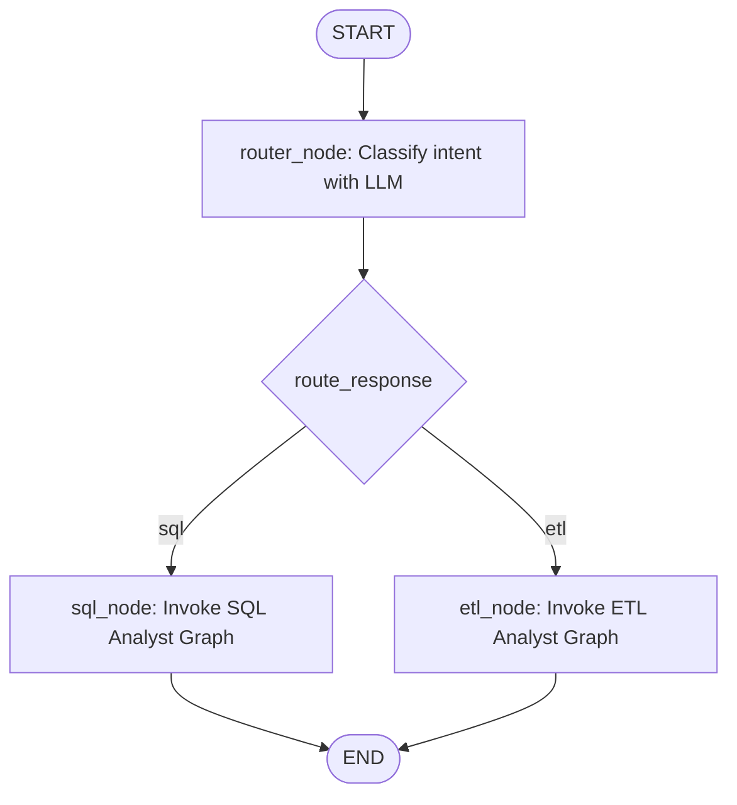
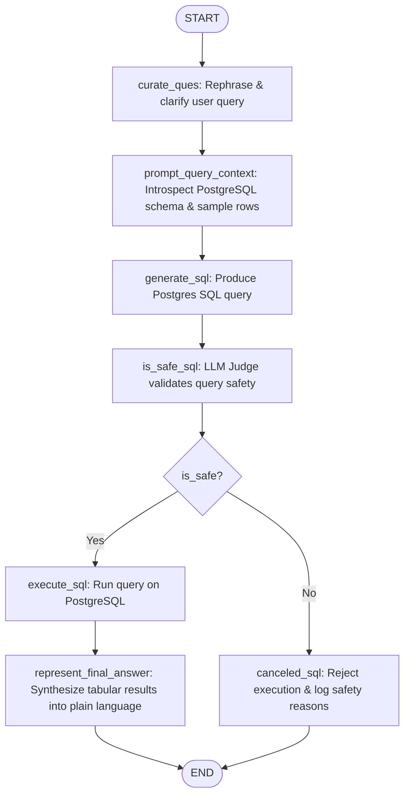
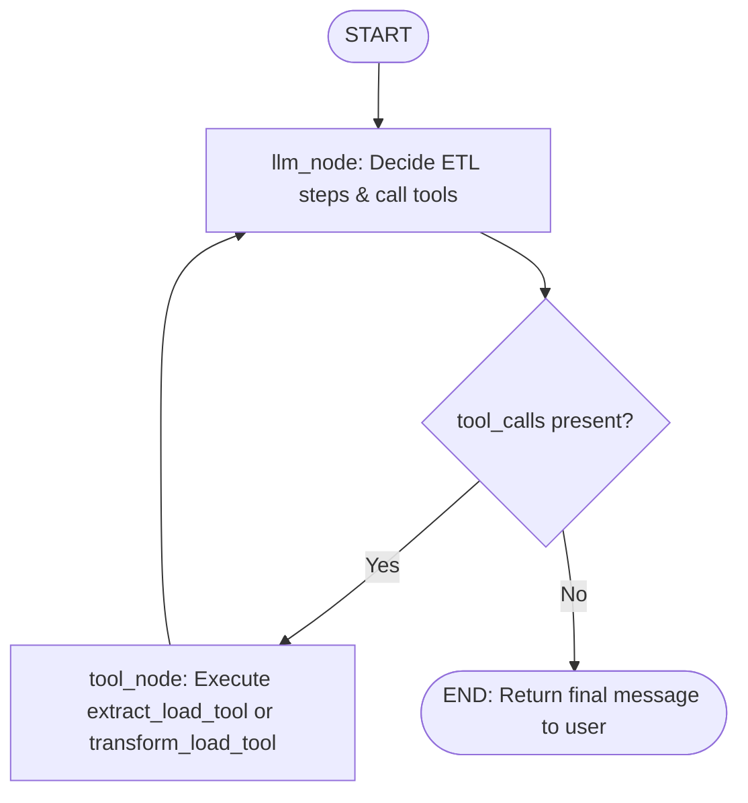
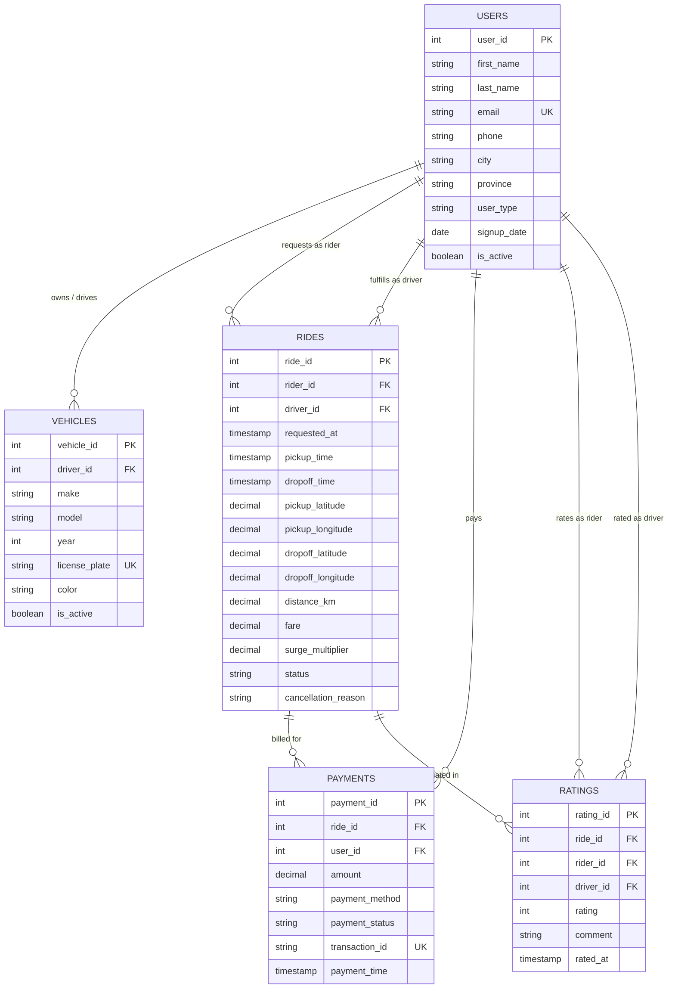

# 🤖 SQL-AGENT: Autonomous Data Analysis & ETL Multi-Agent Framework

A multi-agent data engineering and business intelligence system built with **LangGraph**, **LangChain**, and **PostgreSQL**. The system provides an autonomous conversational interface capable of understanding complex user requests, intelligently routing between **Natural Language to SQL Analysis** and **Automated ETL Pipeline Operations**, verifying query security, executing transformations, and presenting human-readable answers.

---

## 📑 Table of Contents

- [Overview](#-overview)
- [System Architecture](#-system-architecture)
  - [1. Master Data Agent (Supervisor / Router)](#1-master-data-agent-supervisor--router)
  - [2. SQL Analyst Agent (NL-to-SQL + Safety Guardrail)](#2-sql-analyst-agent-nl-to-sql--safety-guardrail)
  - [3. ETL Analyst Agent (ReAct Pipeline Automation)](#3-etl-analyst-agent-react-pipeline-automation)
- [Project Directory Structure](#-project-directory-structure)
- [State Schemas & Data Contracts](#-state-schemas--data-contracts)
- [Detailed Component Breakdown](#-detailed-component-breakdown)
  - [LLM Selection & Tiering (`utils/llm_picks.py`)](#llm-selection--tiering-utilsllm_pickspy)
  - [Database Utility & Schema Introspection (`utils/database.py`)](#database-utility--schema-introspection-utilsdatabasepy)
  - [ETL Toolkit (`utils/etl_tools.py`)](#etl-toolkit-utilsetl_toolspy)
  - [Master Data Agent (`agents/data_agent.py`)](#master-data-agent-agentsdata_agentpy)
  - [SQL Analyst Agent (`agents/sql_analyst.py`)](#sql-analyst-agent-agentssql_analystpy)
  - [ETL Analyst Agent (`agents/etl_analyst.py`)](#etl-analyst-agent-agentsetl_analystpy)
- [Database Schema (Ride-Sharing Domain)](#-database-schema-ride-sharing-domain)
- [Prompts & System Instructions](#-prompts--system-instructions)
- [Installation & Setup](#-installation--setup)
- [Usage & Execution](#-usage--execution)
- [Security, Guardrails & Best Practices](#-security-guardrails--best-practices)
- [AI Model Context & Ingestion Guide](#-ai-model-context--ingestion-guide)

---

## 🌟 Overview

The **SQL-AGENT** system bridges the gap between raw analytical queries on structured databases and programmatic data extraction/transformation tasks. It operates as a hierarchical multi-agent state graph:

1. **User Intent Classification**: Incoming queries are processed by a supervisor router that classifies the intent as either an analytical database query (`sql`) or an ETL operation (`etl`).
2. **Safe NL-to-SQL Conversion**: Natural language questions are automatically rephrased, mapped to real database schemas with column types and sample rows, converted to executable PostgreSQL queries, and checked against a dedicated security judge before execution.
3. **Automated ETL Operations**: REST APIs are queried to fetch JSON payloads, parsed into tabular formats (CSV, JSON, Parquet), dynamically inspected for schema context, transformed via LLM-generated Pandas code, and saved to designated target directories.

---

## 🏗 System Architecture

### 1. Master Data Agent (Supervisor / Router)

The entry point for all user requests is the `data_agent` state graph. It parses the incoming message and uses structured output to classify the query route.



### 2. SQL Analyst Agent (NL-to-SQL + Safety Guardrail)

A sequential multi-step pipeline with an automated safety gate to prevent unauthorized data mutations or deletions:



### 3. ETL Analyst Agent (ReAct Pipeline Automation)

A cyclic tool-calling agent that iteratively determines required actions, extracts API endpoints, inspects sample data, and generates & runs Python Pandas code:



---

## 📁 Project Directory Structure

```
SQL-AGENT/
│
├── .env                              # Environment configuration (DB credentials & API keys)
├── .gitignore                        # Git exclusion rules
├── .python-version                   # Python version specification (3.11+)
├── pyproject.toml                    # Project dependencies and packaging metadata
├── uv.lock                           # UV / pip lockfile
├── README.md                         # Project documentation and AI reference guide
├── feed_db.py                        # Database setup: DDL schemas & CSV data loader
├── main.py                           # Application entry point for sample agent invocations
├── test_schema_details.txt           # Sample dump of introspected database schema & rows
│
├── agents/                           # LangGraph agent definitions & graph visualizations
│   ├── data_agent.py                 # Master supervisor router agent (dispatches to SQL or ETL)
│   ├── data_agent_graph.png          # Visual graph rendering of the Data Agent
│   ├── data_graph.py                 # Standalone graph builder for Data Agent schema visualization
│   ├── etl_analyst.py                # ReAct ETL agent with tool bindings (extract & transform)
│   ├── etl_analyst_graph.png         # Visual graph rendering of the ETL Analyst
│   ├── etl_graph.py                  # Standalone graph builder for ETL Analyst schema visualization
│   ├── sql_analyst.py                # Multi-node SQL generation, safety validation & execution agent
│   └── sql_agent_graph.png           # Visual graph rendering of the SQL Analyst
│
├── models/                           # Pydantic schemas and state specifications
│   └── schema.py                     # AgentSchema, JudgeSchema, ETLAgentSchema, RouterSchema, DataAgentSchema
│
├── utils/                            # Core utilities, database connectors, and toolkits
│   ├── database.py                   # PostgreSQL connection & dynamic schema extraction utility
│   ├── etl_tools.py                  # API fetching, schema inspection, and dynamic code execution
│   └── llm_picks.py                  # Model routing tier based on reasoning complexity (low/medium/high)
│
├── data/                             # Seed dataset and file pipeline storage
│   ├── payments.csv                  # Ride-sharing payment transactions
│   ├── ratings.csv                   # User and driver ride ratings
│   ├── rides.csv                     # Historical ride records
│   ├── users.csv                     # User accounts (riders and drivers)
│   ├── vehicles.csv                  # Driver vehicle registration details
│   ├── extract/                      # Destination directory for extracted raw API outputs
│   └── transform/                    # Destination directory for transformed analytical datasets
│
└── raw_data/                         # Workspace for temporary extracted files
    └── extracted_data.csv            # Sample extracted API dataset
```

---

## 📊 State Schemas & Data Contracts

All agents communicate using structured Pydantic models defined in [`models/schema.py`](file:///d:/CollageProject/SQL-AGENT/models/schema.py).

### 1. `AgentSchema` (SQL Analyst State)
Used as the internal state for [`agents/sql_analyst.py`](file:///d:/CollageProject/SQL-AGENT/agents/sql_analyst.py):
| Field | Type | Description |
| :--- | :--- | :--- |
| `messages` | `Annotated[list, add]` | Accumulator list of conversation messages. |
| `user_question` | `str` | The raw input question submitted by the user. |
| `curated_ques` | `str` | Cleaned and rephrased user question optimized for SQL generation. |
| `prompt_query_context` | `str` | Full prompt including introspected schema info and execution instructions. |
| `generated_sql_query` | `str` | Raw PostgreSQL statement generated by the LLM. |
| `is_safe` | `Literal["Yes", "No"]` | Safety verdict provided by the SQL security judge. |
| `comments` | `str` | Justification and comments from the security judge. |
| `sql_query_execution_result` | `str` | Stringified query execution results from PostgreSQL. |
| `final_answer` | `str` | Natural language synthesis presented back to the user. |

### 2. `JudgeSchema` (Structured Output)
Enforces a rigid response format from the safety judge model:
```python
class JudgeSchema(BaseModel):
    answer: Literal["Yes", "No"] = Field(..., description="Indicates whether the generated SQL query is safe to execute or not")
    comments: str = Field(..., description="Additional comments or feedback from the judge regarding the SQL query")
```

### 3. `RouterSchema` (Structured Output)
Used by the supervisor in [`agents/data_agent.py`](file:///d:/CollageProject/SQL-AGENT/agents/data_agent.py) to direct requests:
```python
class RouterSchema(BaseModel):
    answer: Literal["sql", "etl"] = Field(..., description="Indicates whether the user's question is related to SQL or ETL operations")
    comments: str = Field(..., description="Additional comments or feedback regarding the classification of the user's question")
```

### 4. `ETLAgentSchema` (ETL Analyst State)
```python
class ETLAgentSchema(BaseModel):
    messages: Annotated[list, add] = Field(..., description="List of messages to be processed by the ETL agent")
```

### 5. `DataAgentSchema` (Supervisor State)
```python
class DataAgentSchema(BaseModel):
    messages: Annotated[list, add] = Field(..., description="List of messages to be processed by the Data agent")
    route_response: str = Field(..., description="The response from the router indicating whether to route to SQL or ETL operations")
```

---

## 🔧 Detailed Component Breakdown

### LLM Selection & Tiering (`utils/llm_picks.py`)
Centralized model factory that switches models and parameter configurations based on complexity levels:
- **`low`**: Uses `gpt-5.6-luna` (`temperature=0`, `reasoning_effort="none"`). Used for fast tasks: query curation, final answer formatting, and initial intent routing.
- **`medium`**: Uses `gpt-5.6-terra` (`temperature=0`, `reasoning_effort="none"`). Used for analytical reasoning: SQL code generation, safety judging, and ReAct tool selection.
- **`high`**: Uses `gpt-5.6-sol` (`temperature=0`, `reasoning_effort="none"`). Reserved for deep multi-step queries or high-complexity transformations.

### Database Utility & Schema Introspection (`utils/database.py`)
Encapsulates PostgreSQL interaction via `psycopg2`:
- **`schema_details(schema_name="public")`**: Automatically fetches:
  - All tables in the schema from `information_schema.tables`.
  - All column names and data types from `information_schema.columns`.
  - Up to 5 sample rows per table (`SELECT * FROM {schema}.{table} LIMIT 5`).
  - Formats this metadata into a consolidated text block injected into the LLM prompt.
- **`execute_sql(query)`**: Executes queries against PostgreSQL, performs `cursor.fetchall()`, commits the transaction, and returns stringified results.

### ETL Toolkit (`utils/etl_tools.py`)
Three core utility functions wrapped by agent tools:
1. **`extract_load(url, output_folder, format)`**:
   - Performs an HTTP GET request to a REST API.
   - Extracts JSON and normalizes it using `pd.json_normalize(data['results'])`.
   - Exports the dataframe into `csv`, `json`, or `parquet` at the target folder.
2. **`transform_load_context(file_path)`**:
   - Reads existing tabular files (`.csv`, `.json`, `.parquet`).
   - Returns the top 3 rows (`df.head(3)`) to serve as context for code generation.
3. **`execute_code(code)`**:
   - Executes dynamic Python code strings using `exec(code)` within the local runtime.

### Master Data Agent (`agents/data_agent.py`)
- **`router_node`**: Uses `pick_llm("low").with_structured_output(RouterSchema)` to determine whether the user query is intended for database queries (`sql`) or pipeline tasks (`etl`).
- **`sql_node`**: Prepares the `AgentSchema` payload and calls `sql_analyst.invoke()`.
- **`etl_node`**: Prepares the `ETLAgentSchema` payload and calls `etl_analyst.invoke()`.

### SQL Analyst Agent (`agents/sql_analyst.py`)
Operates as a deterministic LangGraph state machine:
1. **`curate_ques`**: Normalizes slang, corrects ambiguous phrasing, and refines the question.
2. **`prompt_query_context`**: Pulls the live PostgreSQL schema and embeds it alongside the curated question.
3. **`generate_sql`**: Instructs the LLM to output pure executable PostgreSQL SQL, adding a `LIMIT 10` safeguard unless specified otherwise.
4. **`is_safe_sql`**: Evaluates the query against a strict read-only policy. Detects and rejects `INSERT`, `UPDATE`, `DELETE`, `DROP`, `ALTER`, `TRUNCATE`, or `CREATE`.
5. **Conditional Branching (`is_safe_sql_edge`)**:
   - `execute_sql`: Runs only if approved by the judge.
   - `canceled_sql`: Aborts execution if flagged, explaining the judge's feedback.
6. **`represent_final_answer`**: Converts raw database tuples into clean, business-friendly answers.

### ETL Analyst Agent (`agents/etl_analyst.py`)
Implements an autonomous agent with LangChain `@tool` definitions:
- **`extract_load_tool`**: Triggers `ETLTools.extract_load()`.
- **`transform_load_tool`**:
  - Reads data schema context using `transform_load_context`.
  - Prompts an LLM to generate pure Pandas transformation code.
  - Automatically strips Markdown fences and executes the code with `execute_code`.
- **ReAct Execution Loop**: Loops between `llm_node` and `tool_node` until all data processing steps are fulfilled.

---

## 🗄 Database Schema (Ride-Sharing Domain)

The system includes a preconfigured ride-sharing database populated via [`feed_db.py`](file:///d:/CollageProject/SQL-AGENT/feed_db.py) from CSV files in [`data/`](file:///d:/CollageProject/SQL-AGENT/data).



---

## 💬 Prompts & System Instructions

### 1. SQL Generation Prompt (`agents/sql_analyst.py`)
```text
You are an SQL analyst agent. Your task is to convert the user's natural language 
query into Postgres SQL query that can be executed on the database. You are provided 
with the user's original query and the schema details of the database, including
table names, column names, data types, and sample data for each table so that 
you can understand the structure of the database and generate an accurate SQL query.
Unless user explicitly asks for specific number of rows, always limit the output to 10 rows.
Note - Just generate the SQL query without any explanation or additional text because
this query will be executed directly on the database. So, the output should be SQL
ready to be executed without any modifications.  

User's Original Query: {curated_question}

Database Schema Details:
{schema_info}
```

### 2. SQL Safety Judge Prompt (`agents/sql_analyst.py`)
```text
You are an SQL Judge for data security. Your task is to determine whether the SQL query is 
safe or not. The SQL query should only be used for data retrieval and should not modify the 
database in any way. Neither the SQL query nor the prompt should contain any SQL commands that can modify the
database, such as INSERT, UPDATE, DELETE, DROP, ALTER, TRUNCATE, CREATE, or any other commands that can change
the structure or content of the database. If the SQL query is safe, respond with 'Yes' otherwise respond with 
'No'. Additionally, provide comments explaining your decision.
Here's the SQL query to evaluate:
{sql_query}
```

### 3. Pandas Transformation Code Prompt (`agents/etl_analyst.py`)
```text
You are a Python Data Analyst who uses Pandas to analyze data. 
You need to provide only the Pandas Code that will help to perform the right ETL operations on the data stored in the file : {input_file_path}
as per the user's question. Do not provide any explanation or comments, only
the code should be provided. The code should be in a format that can be executed 
in a Python environment with Pandas installed. 
Don't write anything else than Pandas Code. 

Create the Pandas Dataframe from the data stored in the file : {input_file_path} and then 
write the code to transform and save the data at {output_folder}.
Here's the user's question: {user_question}
Here's the context of the data you will be analyzing: {top_3_rows}
```

---

## ⚙️ Installation & Setup

### 1. Prerequisites
- **Python 3.11+** installed.
- **PostgreSQL 14+** running locally or accessible remotely.
- Package manager: [`uv`](https://github.com/astral-sh/uv) (recommended) or `pip`.

### 2. Clone and Install Dependencies
```bash
git clone <repo-url>
cd SQL-AGENT

# Using uv (fastest)
uv sync

# Or using standard pip
python -m venv .venv
source .venv/bin/activate  # On Windows: .venv\Scripts\activate
pip install -e .
```

### 3. Configure Environment Variables
Create or verify the `.env` file in the root directory:
```dotenv
# Database Configuration
database=postgres
host=localhost
user=postgres
password=your_password
port=5432

# Model Provider API Keys
OPENAI_API_KEY="your-openai-key"
# Optional fallback providers configured in .env:
# GROQ_API_KEY="..."
# GEMINI_API_KEY="..."
# OPENROUTER_APIKEY="..."
```

### 4. Populate PostgreSQL Database
Run the seed script to create all relational tables and bulk-import sample CSV data using PostgreSQL `COPY`:
```bash
python feed_db.py
```

---

## 🚀 Usage & Execution

### 1. Run the Primary Data Agent
Execute [`main.py`](file:///d:/CollageProject/SQL-AGENT/main.py):
```bash
python main.py
```

Example programmatic invocation:
```python
from agents.data_agent import data_agent
from langchain_core.messages import HumanMessage

# 1. Analytical Database Query
response_sql = data_agent.invoke({
    "messages": [HumanMessage(content="What are the top 5 most common payment methods and their total revenue?")],
    "route_response": ""
})
print("SQL Result:", response_sql)

# 2. ETL Ingestion & Transformation Task
response_etl = data_agent.invoke({
    "messages": [HumanMessage(content="Extract data from 'https://pokeapi.co/api/v2/pokemon' and save it to data/extract as a csv")],
    "route_response": ""
})
print("ETL Result:", response_etl)
```

### 2. Standalone Sub-Agent Execution
- **Run Interactive Streamlit Web App**:
  ```bash
  uv run streamlit run app.py
  ```
- **Run SQL Analyst directly**:
  ```bash
  uv run python agents/sql_analyst.py
  ```
- **Run ETL Analyst directly**:
  ```bash
  uv run python agents/etl_analyst.py
  ```

### 3. Exporting Graph Visualizations
Generate and view updated Mermaid architecture diagrams:
```bash
uv run python agents/data_graph.py   # Generates data_agent_graph.png
uv run python agents/etl_graph.py    # Generates agents/etl_analyst_graph.png
uv run python agents/sql_agent_graph.py  # Generates sql_agent_graph.png
```

---

## 🛡 Security, Guardrails & Best Practices

1. **Strict Read-Only SQL Policy**:
   - The SQL Analyst passes every generated statement to `is_safe_sql`.
   - Any query matching DDL (`DROP`, `ALTER`, `CREATE`, `TRUNCATE`) or DML mutation (`INSERT`, `UPDATE`, `DELETE`) is aborted with a refusal message explaining the violation.
2. **Default Result Row Limiting**:
   - The system prompt instructs the SQL generator to default to `LIMIT 10` unless explicitly requested by the user, preventing memory exhaustion and large database payload transfers.
3. **Python Execution Sandboxing Note**:
   - The ETL agent uses `exec()` in [`utils/etl_tools.py`](file:///d:/CollageProject/SQL-AGENT/utils/etl_tools.py). For untrusted production deployments, it is recommended to run this inside an isolated Docker container, a virtualized WebAssembly environment, or a sandbox such as e2b or gVisor.

---

## 🧠 AI Model Context & Ingestion Guide

> **For other AI Models, Code Interpreters, and Autonomous Agents reading this repository:**

When extending, debugging, or analyzing this project, adhere to the following architecture rules:

1. **State Isolation**:
   - Always verify which state schema is being consumed. `AgentSchema` is strictly for `sql_analyst.py`, `ETLAgentSchema` is for `etl_analyst.py`, and `DataAgentSchema` is for `data_agent.py`.
   - Modifying state attributes requires updating Pydantic classes in [`models/schema.py`](file:///d:/CollageProject/SQL-AGENT/models/schema.py).
2. **Message Accumulation**:
   - All state schemas use `Annotated[list, add]` for message tracking. Do not overwrite `state.messages`; always return additions or append to lists.
3. **Database Schema Dynamic Introspection**:
   - The SQL Analyst does not hardcode table definitions. Any changes made to PostgreSQL schemas via SQL migrations or `feed_db.py` are dynamically picked up by `DatabaseUtil.schema_details()` on the next execution.
4. **Structured Routing Convention**:
   - Intent routing relies on `RouterSchema`. Any new agent domain (e.g., Vector RAG, Visualization Agent) should be added to `RouterSchema.answer` as an allowed literal, with a corresponding node added to `data_agent_graph`.
5. **Model Tiers**:
   - Keep model assignments aligned with [`utils/llm_picks.py`](file:///d:/CollageProject/SQL-AGENT/utils/llm_picks.py). Avoid hardcoding specific provider strings inside individual agent files.
